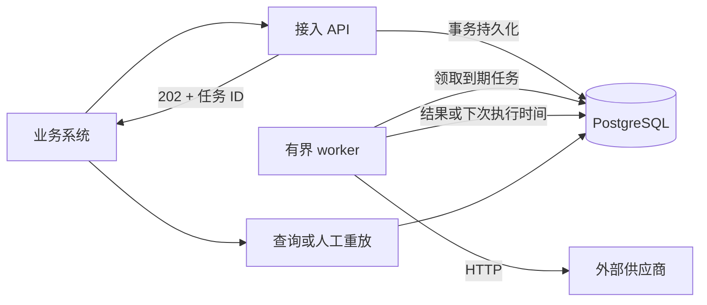

# API 通知服务

Java 17 + Spring Boot 4.1.1 + PostgreSQL 的内部 HTTP 通知 MVP。业务方提交完整 HTTP 请求，服务在数据库事务提交后返回任务 ID，后台进行投递、有限重试和故障恢复。

**契约：持久化受理、允许重复、有限重试、最终失败可查询。** 外部系统永久不可用时不保证成功；外部 HTTP 2xx 只表示 HTTP 层接受/处理了请求，不保证对方后续业务执行完成。

## 阅读与复现入口

| 评估关注点 | 说明与证据 |
| --- | --- |
| 问题拆解、系统边界 | [设计说明](docs/DESIGN.md)：责任起止、解决的问题及不解决的原因 |
| 复杂度管理、工程取舍 | [设计说明](docs/DESIGN.md)：组件成本、替代方案和演进触发条件 |
| 对 AI 输出的判断与修正 | [AI 使用说明](docs/AI_USAGE.md)：实际选择、未采纳候选和修正前后的证据 |
| 故障场景中的工程判断 | [验证记录与复现路径](docs/VERIFICATION.md)：并发幂等、进程崩溃、数据库故障与验证限制 |

本文负责启动、接口和运行参数；设计说明逐项回答作业要求的系统边界、投递语义、长期失败处理、复杂度取舍与演进。AI 使用说明区分提交者实际决定、采用的 AI 技术分析和真实纠错记录。

## 启动

需要 JDK 17+、Maven 3.6.3+、PostgreSQL 17。先准备本地配置：

```bash
cp .env.example .env
# 按实际环境修改 .env 中的数据库密码、API key 和允许的供应商 origin。
set -a
. ./.env
set +a
```

使用原生 PostgreSQL 时，可用以下命令首次创建项目自己的开发数据库（以 macOS Homebrew 安装为例）；再次启动时只执行 `pg_ctl ... start`。其他系统将 `PG_BIN` 改为 PostgreSQL 的 bin 目录。默认使用本机 5432 端口，如已有服务可直接配置其连接信息。

```bash
export PG_BIN=/opt/homebrew/opt/postgresql@17/bin
mkdir -p .local
"$PG_BIN/initdb" -D .local/dev-db -U "$DB_USER" -A scram-sha-256 \
  --pwfile=<(printf '%s\n' "$DB_PASSWORD") --encoding=UTF8 --locale=C
"$PG_BIN/pg_ctl" -D .local/dev-db -l .local/dev-db.log -o '-h 127.0.0.1 -p 5432 -k /tmp' -w start
PGPASSWORD="$DB_PASSWORD" "$PG_BIN/createdb" -h 127.0.0.1 -U "$DB_USER" notifications
```

使用 Docker 时可将以上数据库命令替换为 `docker compose up -d --wait`。已有 PostgreSQL 时只需在 `.env` 设置连接信息。然后构建并启动应用：

```bash
mvn package -DskipTests
java -jar target/notification-service-0.1.0.jar
```

停止本地开发数据库：`"$PG_BIN/pg_ctl" -D .local/dev-db -m fast -w stop`；Compose 环境使用 `docker compose down`。

应用默认只监听 `127.0.0.1:8080`。容器部署时可设置 `SERVER_ADDRESS=0.0.0.0`。必需配置至少一个调用方 key 和一个目标 origin；空配置会拒绝启动。

另开终端运行模拟供应商：

```bash
python3 scripts/mock_supplier.py
```

供应商示例地址：`/ok` 成功；`/flaky` 前两次 503 后成功；`/permanent-fail` 返回 400；`/always-fail` 始终 503；`/slow` 延迟 15 秒；`/redirect` 返回 302；`/retry-after` 返回 429 和 Retry-After。

为快速演示重试，可用 `--notify.backoff-base=1s --notify.backoff-cap=5s` 启动应用；正式默认参数见后文。

## API 示例

```bash
curl -i http://127.0.0.1:8080/notifications \
  -H "X-API-Key: $NOTIFY_API_KEY" \
  -H 'Content-Type: application/json' \
  -d '{"request_id":"registration-1001","url":"http://127.0.0.1:9090/flaky","method":"POST","headers":{"Content-Type":"application/json"},"body":"{\"user_id\":1001}"}'
```

新任务返回 `202`、`Location` 和 JSON；再次提交相同调用方、相同 request_id、相同请求，返回 `200` 和已有任务。相同键对应不同请求返回 `409`，不会覆盖原任务。`request_id` 支持 1–128 位字母、数字、`.`、`_`、`:`、`-`。

数据库访问、事务建立或提交/回滚失败时，返回 `503` 和 `{"error":"storage_unavailable"}`。受理结果可能不确定，例如事务已提交但确认丢失；调用方应使用相同 `request_id` 和相同内容重试，以查询或复用已受理任务。

```bash
curl http://127.0.0.1:8080/notifications/TASK_ID -H "X-API-Key: $NOTIFY_API_KEY"
curl 'http://127.0.0.1:8080/notifications?status=failed&limit=20&offset=0' -H "X-API-Key: $NOTIFY_API_KEY"
curl -X POST http://127.0.0.1:8080/notifications/TASK_ID/replay \
  -H "X-API-Key: $NOTIFY_API_KEY" -H 'Content-Type: application/json' \
  -d '{"request_id":"registration-1001-replay-1"}'
```

查询返回状态、尝试次数、下次执行时间、最后 HTTP 状态/错误及逐次历史，不返回请求体或凭据。失败列表最多每页 100 条。重放仅接受 `failed` 任务，创建关联新任务、重置预算并保留原记录；重复重放请求使用相同的新 request_id。重放保留供应商幂等键，操作者仍需确认该通知是否适合重新执行。

API key 映射到 client_id。所有接口按调用方隔离，其他调用方的任务返回 404。多调用方可配置 `notify.clients.crm=...`、`notify.clients.ads=...`，每个调用方使用不同 key。

## 架构与核心设计



- `notifications` 保存请求、状态、预算计数、下次投递时间和租约；`attempts` 保存逐次尝试。唯一约束 `(client_id, request_id)` 和请求指纹实现接入幂等，键在记录保留期间有效。
- 接入使用 `INSERT ... ON CONFLICT DO NOTHING`，同一事务内读取并核对请求指纹，提交后才返回受理成功。
- worker 以短事务 `FOR UPDATE SKIP LOCKED` 领取任务，先保存租约和尝试记录，再在事务外发送 HTTP。
- 过期租约可重新领取。旧尝试记录为 `unknown`；结果写回必须匹配本次 token，任务和尝试结果在同一事务提交。
- 调度器只负责唤醒扫描。固定线程池和信号量限制并发，只有取得执行槽位才领取任务；无内存队列承担持久化责任。

状态流转：`pending → processing → succeeded / failed / pending（等待重试）`。进程崩溃不依赖内存计时器恢复，重启后继续扫描数据库。

## 失败策略

| 情况 | 处理 |
| --- | --- |
| 2xx，包括 202 | HTTP 投递成功，不解释响应体 |
| 超时、连接中断、临时 TLS 等 I/O 错误 | 在预算内重试；结果可能未知 |
| 408、429、500、502、503、504 | 在预算内重试 |
| 其他非 2xx | 终止失败；不自动跟随 3xx |
| TLS 证书/身份/协议校验失败、目标不允许、无效出站请求 | 终止失败 |
| 尝试次数或时间预算耗尽 | 保存终态与原因，供查询/人工重放 |

默认最多 **20 次领取尝试（含首次）或受理后 24 小时**，先达到者为准。崩溃发生在领取后、真正发送前，也会消耗一次预算；次数不是对方收到请求的次数。截止时间限制新尝试的启动与重试调度，截止前已开始的请求可在自身超时内结束。

第 k 次失败后的退避上界是 `min(30s × 2^(k-1), 1h)`，实际等待随机落在其一半到全部之间。429/503 的合法 Retry-After 同时支持秒数和三种 HTTP 日期格式，取它与本地退避中更晚者；不会用本地一小时上限缩短供应商要求。下一次执行超出 24 小时窗口时直接终止。

| 配置项 | 默认值 |
| --- | --- |
| `notify.concurrency` | 每实例 4 |
| `notify.poll-millis` | 1000 |
| `notify.request-timeout` | 10s，等待 HTTP 响应头的总请求超时 |
| `notify.lease-duration` | 30s，必须大于请求超时 |
| `notify.max-attempts` / `notify.max-age` | 20 / 24h |
| `notify.backoff-base` / `notify.backoff-cap` | 30s / 1h |
| `NOTIFY_WORKER_ENABLED` | true，可设 false 仅运行 API |

仅获取供应商响应状态后关闭响应流，不下载无界响应体。错误和日志只记录固定错误代码、任务 ID、尝试次数等信息。

## 系统边界与取舍

**为什么使用 PostgreSQL 任务表：** 接入、任务状态、领取与尝试历史能使用同一事务；不需要额外消息队列以及状态库/队列双写协议。代价是自行实现调度、租约恢复，并承担数据库轮询成本。SQLite 是单实例的更简单替代；消息队列适合未来已明确的吞吐或隔离需求。

**重复与漏发：** 对方已处理但响应丢失，或本服务发送成功后未保存结果就崩溃，都可能重发。接入幂等只防止重复建任务；业务方应携带供应商支持的稳定事件 ID/幂等键。当前采用允许重复的有限重试，不承诺外部业务 exactly-once，也不把有限预算表述为无条件保证至少送达一次。

**供应商适配：** 业务方组装 URL、method、headers 和 UTF-8 文本 body。支持 GET/POST/PUT/PATCH/DELETE；不做业务响应码解析、OAuth token 刷新、临时签名重算、二进制附件或严格顺序投递。签名/凭据需要在整个重试窗口内有效，否则调用方应重新构造请求。

**限制与部署假设：**

- 目标 origin（协议、主机、端口）必须由可信配置登记；入站和出站均检查。白名单应仅包含可信供应商，不接入用户可控制的域名；没有实现不可信域名的完整 DNS/IP 出站隔离。
- 请求体最多 1 MiB，API JSON 信封最多 8 MiB（为转义膨胀留足空间）；不接受 NUL 字符或无法无损编码为 UTF-8 的文本。出站头最多 64 个、合计 16 KiB，使用 ASCII 名称/值；协议管理的 Host、Content-Length、Connection 等字段禁止覆盖。
- 请求及供应商凭据会为重试而保存在数据库中；需要限制数据库与备份访问。应用不提供独立密钥托管或字段加密。
- 责任从受理事务提交开始；业务操作成功但尚未提交通知的缺口，由业务方的事务发件箱等机制处理。
- 进程恢复依赖数据库和持久化存储完好；不包含数据库灾难恢复。多实例需要时钟同步和一致配置，共享并发池没有按供应商隔离或限流。
- `schema.sql` 提供 MVP 的幂等建表；后续表结构演进应使用受控数据库迁移。第一版不自动清理历史，运营规模增长后需设计保留与归档策略。

**演进：** 先量测积压、失败率与数据库负载，再调整索引和并发；按供应商加配额与告警；必要时拆分 API/worker 或引入消息队列，并用事务发件箱处理双写；供应商鉴权差异显著时增加适配器。第一版暂缓管理 UI、复杂工作流和跨区域部署。

## 验证

单元测试：

```bash
mvn test
```

完整验证需要 Python 3 和原生 PostgreSQL 工具，脚本会创建临时目录/数据库，运行单元与集成测试、打包应用的强制终止和重启场景，然后清理临时数据库：

```bash
bash scripts/verify.sh
```

macOS Homebrew 可安装 `postgresql@17`；脚本会识别其默认位置，其他位置通过 `PG_BIN=/path/to/postgres/bin` 指定。已有测试数据库时设置 `TEST_DB_URL`、`TEST_DB_USER`、`TEST_DB_PASSWORD` 后运行同一命令；**只能指定可丢弃的测试数据库，集成测试会清空其通知表。**

需要 Maven 镜像时通过脚本透传标准参数，例如 `bash scripts/verify.sh -s /path/to/settings.xml`；不依赖提交者个人 Maven 配置。CI 使用独立 PostgreSQL service 运行同一流程。

打包后可进一步运行 `python3 scripts/verify_storage_outage.py`：它始终创建自己的临时 PostgreSQL，验证数据库停止时的 503、重启后的恢复以及同键重试。需要本机 PostgreSQL 工具，目录同样可通过 `PG_BIN` 指定。它是独立的补充实验，不会操作 `TEST_DB_URL` 指向的数据库。

覆盖：并发幂等提交、内容冲突、调用方隔离、数据库写失败、请求边界、失败重放、准确 HTTP 转发、暂时/永久失败、超时重复、重试预算、并发领取、租约恢复、旧 token 拒绝写回、结果与历史原子提交，以及真实应用进程的崩溃恢复。

## 文档

- [设计说明](docs/DESIGN.md)
- [AI 使用说明](docs/AI_USAGE.md)
- [验证记录与复现路径](docs/VERIFICATION.md)

仓库名按题目使用 `rc_cxzg007`。仓库包含正式文档、源码、测试、示例配置、运行脚本和 CI；原始 PDF、面试日历、过程草案、本地配置、代码索引和构建产物不属于提交内容。
