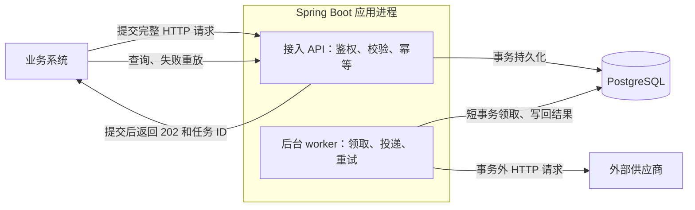

# API 通知系统：设计与工程判断

本文描述当前实现。参数和接口示例见 [README](../README.md)，实际检查结果见 [验证记录](VERIFICATION.md)，AI 建议与用户决定的来源见 [AI 使用说明](AI_USAGE.md)。

## 问题理解与拆解

多个业务系统需要通知外部供应商，但供应商的延迟和可用性不受本方控制。业务方提交完整 HTTP 请求，确认服务已持久化受理后即可继续业务流程，后续投递与失败处理由通知服务负责。

将“尽可能可靠”拆成可以观察和验证的行为：

| 风险 | 当前处理 | 验证入口 |
| --- | --- | --- |
| 返回受理后进程崩溃，内存任务丢失 | 数据库事务提交后才返回 202 | `NotificationRepository.insert`；`scripts/smoke.py` |
| 接入响应丢失，调用方重复提交 | 调用方与 request_id 联合唯一，相同内容复用原任务，冲突返回 409 | `NotificationApiIT.concurrentSubmissionsCreateExactlyOneTask` |
| 供应商暂时不可用 | 有限重试、指数退避和随机等待 | `DeliveryIT.transientFailureWaitsUntilDueThenSucceeds`；`RetryPolicyTest` |
| 发送过程中进程崩溃或结果写回失败 | 持久化租约、过期恢复、旧 token 拒绝写回 | `DeliveryIT.crashedClaimIsRecoveredAndOldTokenCannotOverwriteNewClaim` |
| 失败长期积压、无人能解释 | 有限预算、失败列表、逐次历史和人工重放 | `DeliveryIT.attemptAndAgeBudgetsStopFurtherDelivery`；`NotificationApiIT.replayOnlyFailedTaskAndKeepHistory` |

测试文件位于 [src/test/java/com/rightcapital/notifications](../src/test/java/com/rightcapital/notifications)。题目未规定吞吐量、延迟目标或跨区域可用性，因此当前没有宣称容量上限或服务等级承诺。

## 系统边界

**责任从接入事务提交开始，到 HTTP 投递成功或终止失败为止。** 系统接收 URL、方法、Headers 和 UTF-8 文本 Body，负责鉴权与目标校验、持久化、异步投递、重试、进程恢复、状态查询和失败重放。

| 当前边界 | 原因与责任归属 |
| --- | --- |
| HTTP 2xx 作为投递成功，不解释供应商业务响应体 | 各供应商业务语义不同；业务完成确认需要明确的供应商协议或后续查询能力 |
| 允许重复，不保证外部副作用只发生一次 | 对方已处理但响应丢失时无法确认结果；下游应支持稳定事件 ID 或幂等键 |
| 有限预算，不保证永久不可用的目标最终成功 | 控制无效消耗和过期通知；最终失败由业务方决定是否重放 |
| 不处理业务成功与提交通知之间的原子性 | 本服务不参与调用方的业务事务；该缺口由调用方事务发件箱等机制处理 |
| 不刷新 Token、不重算临时签名、不接收二进制附件 | 第一版提供通用文本 HTTP 投递；业务方提供能覆盖重试窗口的请求，必要时提交修正后的新任务 |
| 不保证严格顺序，不按供应商分配专属并发 | 当前没有顺序或公平性约束；共享 worker 会受到慢供应商影响，明确接受这一代价 |
| 不提供数据库灾难恢复 | 进程恢复依赖数据库及持久化存储完好；备份、高可用和恢复目标需结合部署环境另行设计 |

API key 确定调用方身份，查询与重放按调用方隔离。目标 origin 由可信配置登记，入站和出站均校验，不自动跟随重定向。完整的不可信域名 DNS/IP 隔离不在本版范围；数据库中会保留出站凭据，部署时必须限制数据库和备份访问。请求体、JSON 信封和 Headers 均设大小限制，具体值见 README。

## 架构与数据流

`notifications` 保存请求、状态、预算、下次执行时间和租约；`attempts` 保存每次尝试。保留这两张表可以同时回答“当前怎样”和“之前发生过什么”。表结构见 [schema.sql](../src/main/resources/schema.sql)。

领取使用 `FOR UPDATE SKIP LOCKED`，先记录租约和尝试，再在事务外发送请求。每个实例默认有 4 个执行槽位，每秒扫描；只有取得槽位才领取，避免先领大量任务再在内存中排队。HTTP 默认超时 10 秒，租约为 30 秒；多实例需要时间同步和一致配置。

结果写回同时更新任务和尝试历史，并检查本次 token。token 保护数据库状态，无法撤回已经发出的 HTTP 请求。状态为 `pending → processing → succeeded / failed / pending（等待重试）`。

## 可靠性与故障窗口

采用“持久化受理、允许重复、有限重试、最终失败可查询”的契约。它采用至少一次处理的思路，但有限预算不能承诺供应商必定收到至少一次。

| 故障发生的位置 | 调用方或数据库看到什么 | 恢复方式与剩余风险 |
| --- | --- | --- |
| 受理事务提交前失败 | 未确认受理；数据库访问或事务异常返回脱敏 503 | 调用方用相同 request_id 和内容重试 |
| 事务已提交，但接入响应丢失 | 调用方无法确定；任务可能已经存在 | 重试命中幂等键；不能仅凭 503 或超时断言任务不存在 |
| 领取后、发送前崩溃 | 存在 processing 任务和尝试记录 | 租约过期后恢复；该领取已消耗一次预算 |
| 供应商已处理，响应丢失或本服务未保存结果 | 对外结果不确定 | 重试可能重复送达；接入幂等无法解决下游副作用 |
| 旧 worker 在任务被重新领取后写回 | token 已变化 | 拒绝旧结果覆盖；旧 HTTP 请求仍可能已产生副作用 |
| 更新任务和尝试历史时发生数据库错误 | 结果事务回滚，租约保留 | 后续按过期租约恢复，历史不会只提交一半 |

成功仅由 HTTP 2xx 判断。超时、连接中断、临时 TLS 故障以及 408、429、500、502、503、504 在预算内重试；其他非 2xx、证书/身份/协议校验失败和无效出站请求终止失败。

预算是最多 20 次领取尝试（含首次），或受理后 24 小时。退避上界从 30 秒指数增长，封顶 1 小时，实际等待随机取其一半到全部。429/503 的有效 Retry-After 与本地退避取较晚者；若到达或超出时间预算，则终止。截止前已启动的请求可在自身超时内结束。

20 次、24 小时、4 个槽位属于可配置的初始策略，没有被描述为压测得出的最优值。失败记录不自动删除；重放使用新 request_id 创建关联任务、重置预算并保留供应商幂等键。凭据或内容需修正时，应显式提交新请求。

### 当前可用性措施的范围

| 能力 | 当前已实现 | 本期限制 |
| --- | --- | --- |
| 重试与恢复 | 持久化重试计划、错误分类、退避与随机等待、租约恢复、失败查询和重放 | 允许重复；总次数与时间预算不是供应商必定收到通知的保证 |
| 超时与资源控制 | 10 秒请求超时；每实例 4 个投递槽位，异常后释放槽位 | API 与 worker 同进程并共享连接池，供应商间没有专属资源或公平调度 |
| 熔断与限流 | 未增加独立熔断或速率限流机制 | 单任务退避不等于供应商熔断；并发上限不等于供应商 QPS 配额，积压也没有容量上限 |
| 故障时的受理行为 | 供应商失败时，在数据库可用的前提下仍可持久化受理；数据库访问或事务异常返回 503 | 不提供备用供应商、备用存储或自动切换服务模式；不把内存暂存当作持久化受理 |

调用方重试提交时使用相同 request_id，复用原任务；投递层再独立管理该任务的尝试预算。当前没有为同一次投递叠加应用级 HTTP 重试循环。增加新的重试、限流或熔断层时，需要重新定义领取计数、实际发送、租约时间和错误记录之间的关系。

## 关键取舍与替代方案

下表是当前实现的技术依据；用户个人选择理由单独记录在 AI 使用说明中。

| 选择 | 当前收益 | 接受的代价 | 替代方案及适用条件 |
| --- | --- | --- | --- |
| Java 17、Spring Boot、Spring JDBC | 沿用已有运行环境；复用 HTTP 接入、事务和配置支持；领取 SQL 可直接检查 | 框架依赖、内存和配置成本 | JDK HTTP 服务、JDBC 与定时执行器可减少框架依赖，但要自行处理更多接口与生命周期细节；语言本身不是可靠性的来源 |
| PostgreSQL 任务表 | 受理、状态、租约和历史使用同一数据库事务 | 独立数据库运维、轮询与任务更新负载、自行维护调度逻辑 | SQLite 可降低单实例部署成本，但需要相应的领取实现；消息队列适用于明确的吞吐/积压要求或已有成熟基础设施 |
| Spring 定时扫描与应用内 worker | 定时器只触发扫描，数据库保留恢复依据，无需单独部署调度服务 | 扫描间隔带来等待，共享进程会争用资源 | JDK 定时执行器可替代唤醒；只有跨进程复杂调度成为要求时才考虑专用调度框架 |
| 允许重复、有限重试 | 在结果不确定时继续争取送达，并限制长期无效消耗 | 下游去重和终态人工处理成本 | 不重试可减少重复风险，但接受更多漏发；无限重试会累积过时任务和资源消耗 |
| 通用 HTTP 与 API 查询/重放 | 先形成完整投递和排障流程，控制供应商适配和界面范围 | 业务方构造请求，运维通过 API 操作 | 鉴权差异和人工操作规模出现后，再引入适配器与管理界面 |

AI 讨论中的独立消息队列、管理 UI、供应商插件系统、全局顺序及跨区域部署，没有进入第一版。暂缓依据是尚无必须付出这些成本的具体约束。事务、幂等、租约及历史记录则保留，因为它们直接决定已承诺故障场景中的行为。候选比较与实际修正见 [AI_USAGE.md](AI_USAGE.md)。

### 哪些 AI 方案超出了当前 MVP 的需要

最直接的实际取舍是：AI 后续建议优先补充重试收益、积压和延迟等观测数据，再调整参数；提交者明确选择把这些工作留给后续扩展。本期用已有日志、尝试历史和故障实验检查核心行为，接受缺少生产容量数据和参数最优性证据的限制。

在候选方案比较中，独立 MQ 需要增加组件及状态/消息一致性处理；管理界面和供应商插件平台会增加界面、接口或扩展协议的维护面；全局严格顺序会约束并行投递。这些能力尚无题目中的明确需求驱动，因此没有进入当前范围。它们是讨论过的候选，不描述为已经实现后被提交者删除的功能。

判断依据是新增复杂度是否直接服务于本期承诺。自研数据库调度同样有租约、并发和事务维护成本；选择较少组件，并不表示没有成本。当前保留这部分复杂度，是为了使受理、恢复和失败处理的行为可检查、可验证。

## 演进条件

以下指标与能力是后续计划，当前尚未实现完整监控、供应商隔离或高可用部署。应先确定业务时效目标，再量测积压量、最老待处理任务年龄、投递延迟、重试比例和数据库负载。

用户于 2026-10-15 明确选择保持当前 MVP 范围，新增观测数据及基于运行数据的参数优化留待后续扩展。本期以已有日志、尝试历史和故障实验验证核心行为，不将下表作为提交前必须完成的功能清单，也不据此宣称重试参数已最优或生产容量已验证。

| 可观察的触发条件 | 优先处理 | 后续评估 |
| --- | --- | --- |
| 持续积压，投递延迟超出业务目标 | 区分供应商慢、worker 不足和数据库瓶颈，优化索引、领取与并发 | 优化后调度负载仍构成瓶颈时评估消息队列；引入双写需补事务发件箱 |
| 慢供应商占用大部分槽位 | 按供应商限制并发与请求速率 | 需要更强隔离时拆分 worker 或队列 |
| 接入与后台执行争抢资源 | 分别观察 API 延迟和 worker 占用 | 拆分部署并独立扩容，保持既有持久化和幂等语义 |
| Token 刷新、动态签名等需求重复出现 | 明确供应商协议与凭据生命周期 | 建立适配器及凭据管理，而非继续要求调用方提供长期有效的静态请求 |
| 失败排查频繁、记录增长显著 | 指标告警、分页排查、受控数据库迁移 | 管理界面和历史归档；清理前重新定义幂等键保留期与重放规则 |
| 出现明确的恢复时间和数据损失目标 | 数据库备份、恢复演练 | 高可用与跨区域方案，并验证其实际恢复能力 |

没有压测数据前，不给出固定 QPS 升级阈值。引入新组件后仍需复验接入幂等、故障恢复和重复风险，不能把扩容视为已经解决投递语义问题。
